# THIẾT KẾ CẤU TRÚC LỚP & LƯỢC ĐỒ CƠ SỞ DỮ LIỆU

## HỆ THỐNG HỌC & THI THỬ LUẬT GIAO THÔNG ĐƯỜNG BỘ TRỰC TUYẾN

> **Học phần:** Niên luận Ngành (CT466)  
> **Kiến trúc:** Tách rời (Decoupled RESTful API)  
> **Mô hình lập trình:** Hướng đối tượng (OOP: Model - Service - Controller)  
> **Hệ quản trị CSDL:** MySQL 8.0 (InnoDB, UTF8mb4)

### Tổ chức cổng giao diện (2026-11-09)
- Cổng học viên và cổng quản trị dùng chung mã nguồn frontend nhưng chạy hai Vite dev server độc lập: học viên `http://localhost:5173`, quản trị `http://localhost:5174`.
- Cổng quản trị mặc định mở đăng nhập, không cung cấp đăng ký; các route quản trị vẫn được bảo vệ bằng JWT/RBAC ở frontend và backend.
- Khi chia sẻ demo bằng ngrok, chỉ mở cổng học viên; cổng quản trị chỉ bind vào loopback.

### Quy ước phân tầng API Backend

- **Routes:** Khai báo endpoint và gắn middleware xác thực, phân quyền, upload.
- **Controllers:** Đọc request, gọi Service và định dạng HTTP response; không gọi Model hoặc truy vấn CSDL trực tiếp.
- **Services:** Thực hiện nghiệp vụ, kiểm tra đầu vào/quyền thao tác và phối hợp các Model; không viết SQL.
- **Models:** Chịu trách nhiệm truy vấn và cập nhật dữ liệu MySQL.

### Trạng thái nghiệp vụ học theo nhóm GPLX (2026-11-08)
- Phạm vi này được cấu hình ở Frontend, không thêm bảng hay thay đổi ERD: A/A1 lọc theo thứ tự chương I–V; B/B1 và C/C1 dùng đủ 7 chương.
- Thi thử vẫn gắn với một `license_type_id` cụ thể và lấy ma trận từ `exam_structure_rules`; lịch sử nhóm lọc nhiều `license_type_id` qua API lịch sử.
- Chi tiết tiến độ và mức kiểm thử hiện tại được ghi trong `Cores/checkpoint.md`.

---

## PHẦN 1: LƯỢC ĐỒ CƠ SỞ DỮ LIỆU (DATABASE SCHEMA)

### 1.1. Sơ đồ Quan hệ Thực thể (Entity Relationship Diagram - ERD)

```mermaid
erDiagram
    USERS ||--o{ EXAM_SESSIONS : "thực hiện"
    LICENSE_TYPES ||--o{ EXAM_SESSIONS : "áp dụng cho"
    LICENSE_TYPES ||--o{ EXAM_STRUCTURE_RULES : "định nghĩa ma trận"
    CHAPTERS ||--o{ QUESTIONS : "chứa"
    CHAPTERS ||--o{ EXAM_STRUCTURE_RULES : "thuộc về"
    QUESTIONS ||--|{ ANSWERS : "có nhiều lựa chọn"
    QUESTIONS ||--o{ EXAM_SESSION_DETAILS : "xuất hiện trong"
    EXAM_SESSIONS ||--|{ EXAM_SESSION_DETAILS : "gồm các câu làm"
    SIGN_CATEGORIES ||--o{ TRAFFIC_SIGNS : "phân loại"
    FINE_CATEGORIES ||--o{ TRAFFIC_FINES : "phân loại"

    USERS {// lớp người dùng
        int id PK
        string full_name
        string email UK
        string password_hash
        string phone
        string avatar "URL/đường dẫn ảnh đại diện, NULL hiển thị chữ cái đầu"
        enum role "student, admin"
        boolean is_active
        datetime created_at
        datetime updated_at
    }

    LICENSE_TYPES {// lớp hạng giấy phép lái xe, cấu hình thông tin và yêu cầu thi
        int id PK
        string code UK "A, A1, B, B1, C, C1, D, D1, D2"
        string name
        int total_questions
        int duration_minutes
        int passing_score
        text description
        boolean is_active
        datetime created_at
    }

    CHAPTERS {// lớp chương lý thuyết, tổ chức các câu hỏi theo chương
        int id PK
        string title
        text description
        int order_number
        datetime created_at
    }

    QUESTIONS {// lớp câu hỏi lý thuyết, lưu nội dung và thông tin câu điểm liệt
        int id PK
        int chapter_id FK
        text content
        string image_url
        boolean is_paralysis "1: Câu điểm liệt"
        text explanation
        boolean is_active
        datetime created_at
        datetime updated_at
    }

    ANSWERS {// lớp đáp án, lưu các lựa chọn trả lời cho câu hỏi
        int id PK
        int question_id FK
        text answer_text
        boolean is_correct "1: Đúng, 0: Sai"
        int order_number
    }

    EXAM_STRUCTURE_RULES {// lớp ma trận đề thi, quy định số câu theo hạng bằng và chương
        int id PK
        int license_type_id FK
        int chapter_id FK
        int question_count "Số câu lấy từ chương"
        int paralysis_count "Số câu điểm liệt bắt buộc"
    }

    EXAM_SESSIONS {// lớp phiên thi, lưu kết quả tổng quan của mỗi lần thi
        int id PK
        int user_id FK
        int license_type_id FK
        int score
        int total_questions
        boolean has_paralysis_failed "1: Rớt do câu điểm liệt"
        boolean is_passed "1: ĐẠT, 0: KHÔNG ĐẠT"
        int time_spent_seconds
        datetime started_at
        datetime submitted_at
    }

    EXAM_SESSION_DETAILS {// lớp chi tiết phiên thi, lưu câu hỏi và đáp án đã chọn
        int id PK
        int exam_session_id FK
        int question_id FK
        int selected_answer_id FK
        boolean is_correct
    }

    SIGN_CATEGORIES {// lớp nhóm biển báo, phân loại biển báo giao thông
        int id PK
        string code UK "CAM, NGUY_HIEM, HIEU_LENH..."
        string name
        text description
    }

    TRAFFIC_SIGNS {// lớp biển báo giao thông, lưu mã, tên và thông tin tra cứu
        int id PK
        int category_id FK
        string sign_code "P.101, W.201..."
        string name
        text description
        string image_url
        datetime created_at
    }

    FINE_CATEGORIES {// lớp nhóm mức phạt, phân loại theo loại phương tiện
        int id PK
        enum vehicle_type "OTO, XE_MAY, KHAC"
        string name
        text description
    }

    TRAFFIC_FINES {// lớp mức xử phạt, lưu hành vi vi phạm và khung tiền phạt
        int id PK
        int fine_category_id FK
        string violation_title
        text violation_detail
        bigint min_fine_amount
        bigint max_fine_amount
        text penalty_addition
        string legal_reference
        datetime created_at
    }
```

---

### 1.2. Từ điển Dữ liệu Chi tiết (Data Dictionary)

#### Bảng 1: `users` (Người dùng & Phân quyền)

| Tên cột         | Kiểu dữ liệu             | Ràng buộc                   | Mô tả                                                       |
| :-------------- | :----------------------- | :-------------------------- | :---------------------------------------------------------- |
| `id`            | INT                      | PK, AUTO_INCREMENT          | Mã định danh người dùng duy nhất                            |
| `full_name`     | VARCHAR(100)             | NOT NULL                    | Họ và tên thí sinh / quản trị viên                          |
| `email`         | VARCHAR(150)             | NOT NULL, UNIQUE            | Email đăng nhập hệ thống                                    |
| `password_hash` | VARCHAR(255)             | NOT NULL                    | Mật khẩu mã hóa băm bằng bcrypt                             |
| `phone`         | VARCHAR(20)              | NULL                        | Số điện thoại liên hệ                                       |
| `avatar`        | VARCHAR(255)             | NULL                        | Đường dẫn ảnh đại diện (mặc định NULL hiển thị chữ cái đầu) |
| `role`          | ENUM('student', 'admin') | DEFAULT 'student'           | Vai trò: `student` (học viên), `admin` (quản trị)           |
| `is_active`     | TINYINT(1)               | DEFAULT 1                   | 1: Hoạt động, 0: Bị khóa                                    |
| `token_version` | INT                      | NOT NULL, DEFAULT 1         | Phiên bản JWT Token (tăng khi đổi mật khẩu/khóa để thu hồi) |
| `created_at`    | TIMESTAMP                | DEFAULT CURRENT_TIMESTAMP   | Thời điểm tạo tài khoản                                     |
| `updated_at`    | TIMESTAMP                | ON UPDATE CURRENT_TIMESTAMP | Thời điểm cập nhật gần nhất                                 |

#### Bảng 2: `license_types` (Hạng giấy phép lái xe)

| Tên cột            | Kiểu dữ liệu | Ràng buộc          | Mô tả                                             |
| :----------------- | :----------- | :----------------- | :------------------------------------------------ |
| `id`               | INT          | PK, AUTO_INCREMENT | Mã định danh hạng bằng                            |
| `code`             | VARCHAR(10)  | NOT NULL, UNIQUE   | Ký hiệu hạng bằng: A, A1, B, B1, C, C1, D, D1, D2 |
| `name`             | VARCHAR(100) | NOT NULL           | Tên đầy đủ (VD: Hạng B1 - Ôtô số tự động...)      |
| `total_questions`  | INT          | NOT NULL           | Tổng số câu hỏi trong 1 đề thi sát hạch           |
| `duration_minutes` | INT          | NOT NULL           | Thời gian thi tính bằng phút                      |
| `passing_score`    | INT          | NOT NULL           | Số câu đúng tối thiểu cần đạt để thi đỗ           |
| `description`      | TEXT         | NULL               | Phạm vi điều khiển phương tiện của hạng bằng      |
| `is_active`        | TINYINT(1)   | DEFAULT 1          | Trạng thái áp dụng thi                            |

#### Bảng 3: `chapters` (Chương lý thuyết 600 câu)

| Tên cột        | Kiểu dữ liệu | Ràng buộc          | Mô tả                                   |
| :------------- | :----------- | :----------------- | :-------------------------------------- |
| `id`           | INT          | PK, AUTO_INCREMENT | Mã định danh chương                     |
| `title`        | VARCHAR(255) | NOT NULL           | Tên chương (Chương I đến Chương VII)    |
| `description`  | TEXT         | NULL               | Tóm tắt nội dung kiến thức trong chương |
| `order_number` | INT          | DEFAULT 1          | Thứ tự hiển thị                         |

#### Bảng 4: `questions` (Ngân hàng câu hỏi sát hạch)

| Tên cột        | Kiểu dữ liệu | Ràng buộc                       | Mô tả                                         |
| :------------- | :----------- | :------------------------------ | :-------------------------------------------- |
| `id`           | INT          | PK, AUTO_INCREMENT              | Mã định danh câu hỏi                          |
| `chapter_id`   | INT          | FK $\rightarrow$ `chapters(id)` | Thuộc chương nào trong giáo trình             |
| `content`      | TEXT         | NOT NULL                        | Nội dung câu hỏi trắc nghiệm                  |
| `image_url`    | VARCHAR(255) | NULL                            | Đường dẫn ảnh sa hình / biển báo minh họa     |
| `is_paralysis` | TINYINT(1)   | DEFAULT 0                       | 1: Câu hỏi điểm liệt (sai là trượt trực tiếp) |
| `explanation`  | TEXT         | NULL                            | Lời giải thích luật và mẹo ghi nhớ đáp án     |
| `is_active`    | TINYINT(1)   | DEFAULT 1                       | 1: Đang sử dụng trong ngân hàng đề            |

#### Bảng 5: `answers` (Phương án trả lời)

| Tên cột        | Kiểu dữ liệu | Ràng buộc                        | Mô tả                                  |
| :------------- | :----------- | :------------------------------- | :------------------------------------- |
| `id`           | INT          | PK, AUTO_INCREMENT               | Mã định danh phương án                 |
| `question_id`  | INT          | FK $\rightarrow$ `questions(id)` | Thuộc câu hỏi nào (ON DELETE CASCADE)  |
| `answer_text`  | TEXT         | NOT NULL                         | Nội dung phương án trả lời             |
| `is_correct`   | TINYINT(1)   | DEFAULT 0                        | 1: Phương án đúng, 0: Phương án sai    |
| `order_number` | INT          | DEFAULT 1                        | Thứ tự hiển thị phương án (1, 2, 3, 4) |

#### Bảng 6: `exam_structure_rules` (Ma trận cấu hình đề thi theo Bộ GTVT)

| Tên cột           | Kiểu dữ liệu | Ràng buộc                            | Mô tả                                       |
| :---------------- | :----------- | :----------------------------------- | :------------------------------------------ |
| `id`              | INT          | PK, AUTO_INCREMENT                   | Mã quy tắc ma trận                          |
| `license_type_id` | INT          | FK $\rightarrow$ `license_types(id)` | Áp dụng cho hạng bằng nào                   |
| `chapter_id`      | INT          | FK $\rightarrow$ `chapters(id)`      | Lấy câu hỏi từ chương nào                   |
| `question_count`  | INT          | DEFAULT 0                            | Số lượng câu hỏi lấy từ chương này          |
| `paralysis_count` | INT          | DEFAULT 0                            | Số câu điểm liệt bắt buộc lấy từ chương này |

#### Bảng 7: `exam_sessions` (Lượt thi của học viên)

| Tên cột                | Kiểu dữ liệu | Ràng buộc                            | Mô tả                                     |
| :--------------------- | :----------- | :----------------------------------- | :---------------------------------------- |
| `id`                   | INT          | PK, AUTO_INCREMENT                   | Mã phiên thi                              |
| `user_id`              | INT          | FK $\rightarrow$ `users(id)`         | Học viên thực hiện bài thi                |
| `license_type_id`      | INT          | FK $\rightarrow$ `license_types(id)` | Hạng bằng tham gia thi                    |
| `score`                | INT          | DEFAULT 0                            | Tổng số câu trả lời đúng                  |
| `total_questions`      | INT          | NOT NULL                             | Tổng số câu trong đề thi                  |
| `has_paralysis_failed` | TINYINT(1)   | DEFAULT 0                            | 1: Bị đánh trượt do sai câu hỏi điểm liệt |
| `is_passed`            | TINYINT(1)   | DEFAULT 0                            | 1: ĐẠT, 0: KHÔNG ĐẠT                      |
| `time_spent_seconds`   | INT          | DEFAULT 0                            | Thời gian hoàn thành bài thi (giây)       |
| `started_at`           | TIMESTAMP    | DEFAULT CURRENT_TIMESTAMP            | Thời điểm phát đề thi                     |
| `submitted_at`         | TIMESTAMP    | NULL                                 | Thời điểm nộp bài thi                     |

#### Bảng 8: `exam_session_details` (Chi tiết câu trả lời trong bài thi)

| Tên cột              | Kiểu dữ liệu | Ràng buộc                            | Mô tả                                        |
| :------------------- | :----------- | :----------------------------------- | :------------------------------------------- |
| `id`                 | INT          | PK, AUTO_INCREMENT                   | Mã chi tiết câu làm                          |
| `exam_session_id`    | INT          | FK $\rightarrow$ `exam_sessions(id)` | Thuộc phiên thi nào                          |
| `question_id`        | INT          | FK $\rightarrow$ `questions(id)`     | Câu hỏi xuất hiện trong đề                   |
| `selected_answer_id` | INT          | FK $\rightarrow$ `answers(id)`       | ID đáp án thí sinh đã chọn (NULL nếu bỏ qua) |
| `is_correct`         | TINYINT(1)   | DEFAULT 0                            | 1: Làm đúng, 0: Làm sai                      |

#### Bảng 9 & 10: `sign_categories` & `traffic_signs` (Hệ thống biển báo đường bộ)

- `sign_categories`: Danh mục 5 nhóm biển báo (`CAM`, `NGUY_HIEM`, `HIEU_LENH`, `CHI_DAN`, `PHU`).
- `traffic_signs`: Chi tiết biển báo (`sign_code` như P.101, W.201; `name`, `description`, `image_url`). Có Fulltext Index trên (`sign_code`, `name`).

#### Bảng 11 & 12: `fine_categories` & `traffic_fines` (Tra cứu mức xử phạt vi phạm)

- `fine_categories`: Phân loại phương tiện (`OTO`, `XE_MAY`, `KHAC`).
- `traffic_fines`: Mức phạt (`violation_title`, `violation_detail`, `min_fine_amount`, `max_fine_amount`, `penalty_addition`, `legal_reference`). Có Fulltext Index trên (`violation_title`, `violation_detail`).

---

## PHẦN 2: THIẾT KẾ CÁC LỚP HƯỚNG ĐỐI TƯỢNG (OOP CLASS DESIGN)

Hệ thống Backend được thiết kế theo mô hình **3 tầng thuần OOP**:

1. **Presentation / API Layer:** Các lớp Controller (`*Controller`)
2. **Business Logic Layer:** Các lớp Service (`*Service`)
3. **Data Access / Domain Entity Layer:** Các lớp Model (`*Model`)

```mermaid
classDiagram
    direction TB

    %% Presentation Layer
    class AuthController {
        +register(req, res, next)
        +login(req, res, next)
        +getMe(req, res, next)
    }

    class QuestionController {
        +getChapters(req, res, next)
        +getQuestions(req, res, next)
        +getQuestionById(req, res, next)
        +getParalysisQuestions(req, res, next)
    }

    class ExamController {
        +getLicenseTypes(req, res, next)
        +generateExam(req, res, next)
        +submitExam(req, res, next)
        +getExamHistory(req, res, next)
        +getExamReview(req, res, next)
    }

    class LookupController {
        +getSignCategories(req, res, next)
        +getSigns(req, res, next)
        +getFines(req, res, next)
    }

    class AISignController {
        +recognizeFromFile(req, res, next)
        +recognizeFromCamera(req, res, next)
    }

    class ChatbotController {
        +sendMessage(req, res, next)
        +clearHistory(req, res, next)
    }

    class UserController {
        +getAll(req, res, next)
        +toggleLock(req, res, next)
        +updateRole(req, res, next)
        +delete(req, res, next)
    }

    class AdminController {
        +getDashboardStats(req, res, next)
        +createQuestion(req, res, next)
        +updateQuestion(req, res, next)
        +deleteQuestion(req, res, next)
        +getExamMatrix(req, res, next)
        +updateExamMatrix(req, res, next)
        +getChapters(req, res, next)
        +getChapterById(req, res, next)
        +createChapter(req, res, next)
        +updateChapter(req, res, next)
        +deleteChapter(req, res, next)
        +getLicenseTypes(req, res, next)
        +getLicenseTypeById(req, res, next)
        +createLicenseType(req, res, next)
        +updateLicenseType(req, res, next)
        +toggleLicenseTypeStatus(req, res, next)
        +deleteLicenseType(req, res, next)
        +getLicenseMatrix(req, res, next)
        +updateLicenseMatrix(req, res, next)
        +getFineCategories(req, res, next)
        +getFines(req, res, next)
        +getFineById(req, res, next)
        +createFine(req, res, next)
        +updateFine(req, res, next)
        +deleteFine(req, res, next)
    }

    %% Service Layer
    class AuthService {
        +generateToken(user) string
        +registerUser(data) Promise
        +loginUser(credentials) Promise
        +getUserById(id) Promise
        +sendPasswordResetOtp(email) Promise
        +verifyPasswordResetOtp(email, otp) Promise
        +resetPassword(email, otp, newPassword) Promise
    }

    class QuestionService {
        +getAllChapters() Promise
        +getQuestionsWithFilter(filter) Promise
        +getQuestionDetail(id) Promise
        +getParalysisOnly() Promise
    }

    class ExamService {
        +generateExamSession(userId, licenseTypeId) Promise
        +evaluateExamSubmission(sessionId, userAnswers, timeSpent) Promise
        +getExamHistoryByUser(userId) Promise
        +getExamReviewDetails(sessionId, userId) Promise
    }

    class LookupService {
        +getSignCategories() Promise
        +searchSigns(categoryId, keyword) Promise
        +searchFines(vehicleType, keyword) Promise
    }

    class AISignService {
        +runInference(inputPathOrBase64) Promise
        +matchWithDatabase(className) Promise
        +recognizeFromFile(file) Promise
        +recognizeFromCamera(base64Image) Promise
    }

    class ChatbotService {
        +chat(sessionId, message) Promise
        +clearSession(sessionId) void
    }

    class UserService {
        +getAll(query) Promise
        +toggleLock(targetUserId, currentAdminId) Promise
        +updateRole(targetUserId, role, currentAdminId) Promise
        +delete(targetUserId, currentAdminId) Promise
    }

    class AdminService {
        +getDashboardStats() Promise
        +getSignCategories() Promise
        +getSigns(query) Promise
        +createSign(data, file) Promise
        +updateSign(id, data, file) Promise
        +uploadSignImage(file) Promise
        +deleteSign(id) Promise
        +getChapters() Promise
        +getChapterById(id) Promise
        +createChapter(data) Promise
        +updateChapter(id, data) Promise
        +deleteChapter(id) Promise
        +getLicenseTypes() Promise
        +getLicenseTypeById(id) Promise
        +createLicenseType(data) Promise
        +updateLicenseType(id, data) Promise
        +toggleLicenseTypeStatus(id) Promise
        +deleteLicenseType(id) Promise
        +getLicenseMatrix(id) Promise
        +updateLicenseMatrix(id, rules) Promise
        +getFineCategories() Promise
        +getFines(query) Promise
        +getFineById(id) Promise
        +createFine(data) Promise
        +updateFine(id, data) Promise
        +deleteFine(id) Promise
    }

    %% Model / Entity Layer
    class AdminDashboardModel {
        +getStats()$ Promise~Object~
    }

    class UserModel {
        +int id
        +string fullName
        +string email
        +string passwordHash
        +string phone
        +string avatar
        +string role
        +boolean isActive
        +datetime createdAt
        +findByEmail(email)$ Promise~UserModel~
        +findById(id)$ Promise~UserModel~
        +existsByEmail(email)$ Promise~boolean~
        +create(data)$ Promise~UserModel~
        +findFiltered(options)$ Promise~Object~
        +updateProfile(id, data)$ Promise~UserModel~
        +setActive(id, status)$ Promise
        +setRole(id, role)$ Promise
        +countExamSessions(id)$ Promise~number~
        +deleteById(id)$ Promise
        +updatePassword(id, hash)$ Promise~boolean~
        +toJSON() Object
    }

    class ChapterModel {
        +int id
        +string title
        +string description
        +int orderNumber
        +findAll()$ Promise~Array~
        +findById(id)$ Promise~ChapterModel~
        +create(data)$ Promise~ChapterModel~
        +update(id, data)$ Promise~ChapterModel~
        +deleteById(id)$ Promise~boolean~
    }

    class QuestionModel {
        +int id
        +int chapterId
        +string content
        +string imageUrl
        +boolean isParalysis
        +string explanation
        +boolean isActive
        +findById(id)$ Promise~QuestionModel~
        +findFiltered(params)$ Promise~Object~
        +findRandomByChapter(chapterId, count, isParalysis)$ Promise~Array~
        +findRandomActive(options)$ Promise~Array~
        +create(data)$ Promise~QuestionModel~
        +update(id, data)$ Promise~boolean~
        +delete(id)$ Promise~boolean~
    }

    class AnswerModel {
        +int id
        +int questionId
        +string answerText
        +boolean isCorrect
        +int orderNumber
        +findByQuestionId(questionId, includeCorrect)$ Promise~Array~
        +findCorrectByQuestionId(questionId)$ Promise~AnswerModel~
        +create(data)$ Promise~AnswerModel~
    }

    class LicenseTypeModel {
        +int id
        +string code
        +string name
        +int totalQuestions
        +int durationMinutes
        +int passingScore
        +findAll(options)$ Promise~Array~
        +findById(id, includeStats)$ Promise~LicenseTypeModel~
        +findByCode(code)$ Promise~LicenseTypeModel~
        +create(data)$ Promise~LicenseTypeModel~
        +update(id, data)$ Promise~LicenseTypeModel~
        +toggleActive(id)$ Promise~LicenseTypeModel~
        +deleteById(id)$ Promise~boolean~
    }

    class ExamStructureRuleModel {
        +int id
        +int licenseTypeId
        +int chapterId
        +int questionCount
        +int paralysisCount
        +findByLicenseTypeId(licenseTypeId)$ Promise~Array~
        +saveRules(licenseTypeId, rules)$ Promise~boolean~
    }

    class ExamSessionModel {
        +int id
        +int userId
        +int licenseTypeId
        +int score
        +int totalQuestions
        +boolean hasParalysisFailed
        +boolean isPassed
        +int timeSpentSeconds
        +datetime startedAt
        +datetime submittedAt
        +create(data)$ Promise~number~
        +findById(sessionId)$ Promise~ExamSessionModel~
        +findQuestionDetailsForGrading(sessionId)$ Promise~Array~
        +updateResult(sessionId, resultData)$ Promise~boolean~
        +findByUserId(userId)$ Promise~Array~
    }

    class TrafficSignModel {
        +int id
        +int categoryId
        +string signCode
        +string name
        +string description
        +string imageUrl
        +findWithFilter(categoryId, keyword)$ Promise~Array~
        +findByRecognitionName(className)$ Promise~Object~
        +create(data)$ Promise~TrafficSignModel~
        +update(id, data)$ Promise~TrafficSignModel~
        +deleteById(id)$ Promise~boolean~
    }

    class TrafficFineModel {
        +int id
        +int fineCategoryId
        +string violationTitle
        +string violationDetail
        +bigint minFineAmount
        +bigint maxFineAmount
        +string penaltyAddition
        +string legalReference
        +searchFines(vehicleType, keyword)$ Promise~Array~
        +create(data)$ Promise~TrafficFineModel~
        +update(id, data)$ Promise~TrafficFineModel~
        +deleteById(id)$ Promise~boolean~
    }

    %% Layer Dependencies
    AuthController ..> AuthService : calls
    QuestionController ..> QuestionService : calls
    ExamController ..> ExamService : calls
    LookupController ..> LookupService : calls
    AISignController ..> AISignService : calls
    ChatbotController ..> ChatbotService : calls
    UserController ..> UserService : calls
    AdminController ..> AdminService : calls

    AuthService ..> UserModel : uses
    QuestionService ..> ChapterModel : uses
    QuestionService ..> QuestionModel : uses
    QuestionService ..> AnswerModel : uses
    ExamService ..> LicenseTypeModel : uses
    ExamService ..> ExamStructureRuleModel : uses
    ExamService ..> QuestionModel : uses
    ExamService ..> AnswerModel : uses
    ExamService ..> ExamSessionModel : uses
    LookupService ..> TrafficSignModel : uses
    LookupService ..> TrafficFineModel : uses
    AISignService ..> TrafficSignModel : uses
    UserService ..> UserModel : uses
    AdminService ..> QuestionModel : uses
    AdminService ..> AnswerModel : uses
    AdminService ..> ExamStructureRuleModel : uses
    AdminService ..> AdminDashboardModel : uses
    AdminService ..> TrafficSignModel : uses
    AdminService ..> ChapterModel : uses
    AdminService ..> LicenseTypeModel : uses
    AdminService ..> TrafficFineModel : uses
```



---

## PHẦN 3: BẢNG ÁNH XẠ KIẾN TRÚC TỔNG THỂ (MAPPING MATRIX)

Bảng tổng hợp đối chiếu trực tiếp giữa **Bảng CSDL**, **Lớp Model**, **Lớp Dịch vụ**, **Lớp Điều khiển** và **Tuyến đường RESTful API**:

| Phân hệ nghiệp vụ               | Bảng CSDL (MySQL)                                                                | Lớp Model (OOP)                                                      | Lớp Service (Business)             | Lớp Controller (API)                     | Endpoint RESTful API chính                                                                                                                                                                                                                                                                                                                                                                                                                                                                                                                                                                                                                                                                                                                                                                                                       |
| :------------------------------ | :------------------------------------------------------------------------------- | :------------------------------------------------------------------- | :--------------------------------- | :--------------------------------------- | :------------------------------------------------------------------------------------------------------------------------------------------------------------------------------------------------------------------------------------------------------------------------------------------------------------------------------------------------------------------------------------------------------------------------------------------------------------------------------------------------------------------------------------------------------------------------------------------------------------------------------------------------------------------------------------------------------------------------------------------------------------------------------------------------------------------------------- |
| **Xác thực & Người dùng**       | `users`                                                                          | `UserModel`                                                          | `AuthService`<br>`UserService`     | `AuthController`<br>`UserController`     | `POST /api/v1/auth/send-register-otp`<br>`POST /api/v1/auth/verify-register-otp`<br>`POST /api/v1/auth/login`<br>`POST /api/v1/auth/forgot-password`<br>`POST /api/v1/auth/verify-otp`<br>`POST /api/v1/auth/reset-password`<br>`GET /api/v1/auth/me`<br>`PUT /api/v1/auth/profile`<br>`GET /api/v1/users`<br>`PATCH /api/v1/users/:id/toggle-lock`<br>`PATCH /api/v1/users/:id/role`<br>`DELETE /api/v1/users/:id` |
| **Ôn tập 600 câu hỏi**          | `chapters`, `questions`, `answers`                                               | `ChapterModel`<br>`QuestionModel`<br>`AnswerModel`                   | `QuestionService`                  | `QuestionController`                     | `GET /api/v1/chapters`<br>`GET /api/v1/questions`<br>`GET /api/v1/questions/:id`                                                                                                                                                                                                                                                                                                                                                                                                                                                                                                                                                                                                                                                                                                                                                 |
| **Tra cứu Biển báo & Mức phạt** | `sign_categories`, `traffic_signs`, `fine_categories`, `traffic_fines`           | `TrafficSignModel`<br>`TrafficFineModel`                             | `LookupService`<br>`AISignService` | `LookupController`<br>`AISignController` | `GET /api/v1/lookup/signs`<br>`GET /api/v1/lookup/signs/:id`<br>`GET /api/v1/lookup/signs/categories`<br>`POST /api/v1/lookup/signs/recognize-file`<br>`POST /api/v1/lookup/signs/recognize-camera`<br>`GET /api/v1/lookup/fines`<br>`GET /api/v1/lookup/fines/:id`<br>`GET /api/v1/lookup/fines/categories`                                                                                                                                                                                                                                                                                                                                                                                                                                                                                                                     |
| **Chatbot hỏi đáp AI**          | _(In-memory, không có CSDL)_                                                     | _(Không có Model)_                                                   | `ChatbotService`                   | `ChatbotController`                      | `POST /api/v1/chatbot/send`<br>`POST /api/v1/chatbot/clear`                                                                                                                                                                                                                                                                                                                                                                                                                                                                                                                                                                                                                                                                                                                                                                      |
| **Thi sát hạch chuẩn GTVT**     | `license_types`, `exam_structure_rules`, `exam_sessions`, `exam_session_details` | `LicenseTypeModel`<br>`ExamStructureRuleModel`<br>`ExamSessionModel` | `ExamService`                      | `ExamController`                         | `GET /api/v1/license-types`<br>`POST /api/v1/exams/generate`<br>`POST /api/v1/exams/:id/submit`<br>`GET /api/v1/exams/history`<br>`GET /api/v1/exams/:id/review`                                                                                                                                                                                                                                                                                                                                                                                                                                                                                                                                                                                                                                                                 |
| **Quản trị Admin Dashboard**    | Toàn bộ 12 bảng                                                                  | Toàn bộ các Model<br>`AdminDashboardModel`                          | `AdminService`                     | `AdminController`                        | `GET /api/v1/admin/dashboard/stats`<br>`POST /api/v1/admin/questions`<br>`PUT /api/v1/admin/license-types/:id/matrix`<br>`GET /api/v1/admin/chapters`<br>`POST /api/v1/admin/chapters`<br>`PUT /api/v1/admin/chapters/:id`<br>`DELETE /api/v1/admin/chapters/:id`<br>`GET /api/v1/admin/license-types`<br>`POST /api/v1/admin/license-types`<br>`PUT /api/v1/admin/license-types/:id`<br>`PATCH /api/v1/admin/license-types/:id/toggle-status`<br>`DELETE /api/v1/admin/license-types/:id`<br>`GET /api/v1/admin/license-types/:id/matrix`<br>`PUT /api/v1/admin/license-types/:id/matrix`<br>`GET /api/v1/admin/fines/categories`<br>`GET /api/v1/admin/fines`<br>`GET /api/v1/admin/fines/:id`<br>`POST /api/v1/admin/fines`<br>`PUT /api/v1/admin/fines/:id`<br>`DELETE /api/v1/admin/fines/:id` |

---

## PHẦN 4: ĐẶC TẢ CHI TIẾT CÁC PHƯƠNG THỨC LỚP CỐT LÕI

### 4.1. Lớp `ExamService` (Bộ máy Sinh đề & Chấm điểm Sát hạch)

- `generateExamSession(userId, licenseTypeId)`:
  - Đọc quy tắc ma trận từ `ExamStructureRuleModel.findByLicenseTypeId(licenseTypeId)`.
  - Với mỗi chương, gọi `QuestionModel.findRandomByChapter(chapterId, count, isParalysis)` để lấy đúng số câu điểm liệt và câu thường.
  - Trộn ngẫu nhiên câu hỏi bằng thuật toán Fisher-Yates shuffle.
  - Lưu phiên thi vào `ExamSessionModel.create(...)` và chi tiết các câu vào `exam_session_details`.
  - Trả về danh sách câu hỏi **đã ẩn đáp án đúng** (thông qua `AnswerModel.findByQuestionId(qId, includeCorrect = false)`).
- `evaluateExamSubmission(sessionId, userAnswers, timeSpentSeconds)`:
  - Lấy danh sách câu hỏi và đáp án đúng thông qua `AnswerModel.findCorrectByQuestionId(...)`.
  - Tính tổng số câu làm đúng.
  - Kiểm tra biến cờ: nếu thí sinh làm sai hoặc bỏ trống câu có `is_paralysis = 1`, đặt `has_paralysis_failed = true`.
  - Phán quyết: `is_passed = (score >= passing_score) && !has_paralysis_failed`.
  - Lưu kết quả vào CSDL và trả về thông báo phản hồi chi tiết.

### 4.2. Lớp `QuestionModel` (Xử lý Ngân hàng câu hỏi)

- `findFiltered({ chapterId, isParalysis, keyword, page, limit })`:
  - Xây dựng câu truy vấn linh hoạt với điều kiện `WHERE` tùy chọn.
  - Tự động đếm `total` để phục vụ phân trang ở Client.
- `findRandomByChapter(chapterId, count, isParalysis)`:
  - Truy vấn ngẫu nhiên `ORDER BY RAND() LIMIT count` đảm bảo mỗi đề thi của các thí sinh đều không bị trùng lặp câu hỏi.
