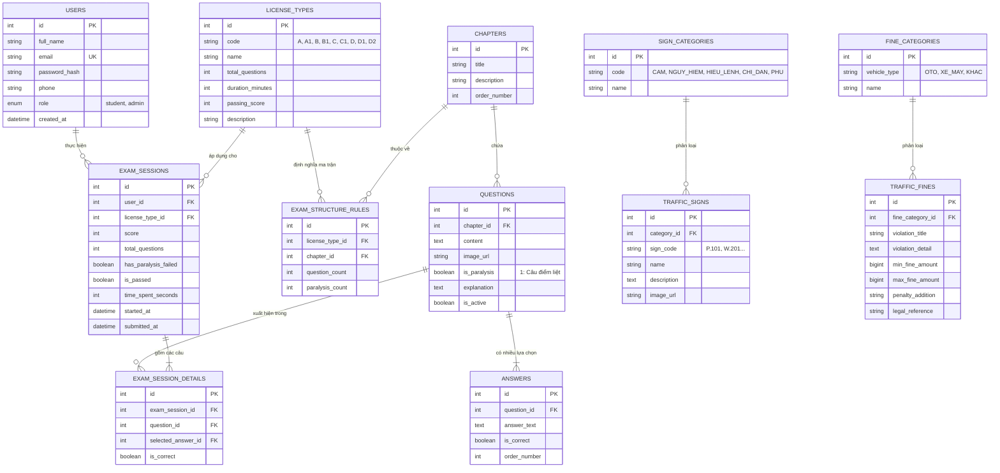
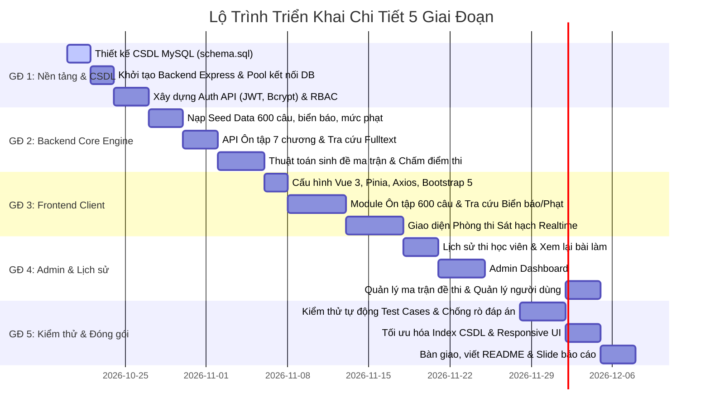

# KẾ HOẠCH XÂY DỰNG CHI TIẾT HỆ THỐNG WEBSITE HỌC VÀ THI THỬ LUẬT GIAO THÔNG ĐƯỜNG BỘ TRỰC TUYẾN

> **Dự án:** Hệ thống Học & Thi Thử Lý Thuyết Giấy Phép Lái Xe Trực Tuyến  
> **Kiến trúc:** Tách rời (Decoupled Architecture / RESTful API)  
> **Công nghệ:** Node.js (Express) + Vue.js 3 + Bootstrap 5 + MySQL  
> **Xác thực & Phân quyền:** JWT (JSON Web Token) & Role-Based Access Control (RBAC)  
> **Tiêu chuẩn:** Bộ 600 câu hỏi lý thuyết & quy chuẩn sát hạch Tổng cục Đường bộ Việt Nam  

> **Trạng thái hiện thực đến 2026-11-09:** Frontend Vue SPA, backend REST API và các phân hệ ôn tập theo nhóm hạng, thi thử, lịch sử, tra cứu và quản trị chính đã được xây dựng. Lối vào ôn tập chung toàn bộ 7 chương đã được gỡ; A/A1 ôn chương I–V, B/B1 và C/C1 ôn đủ 7 chương. Học viên và admin dùng hai cổng frontend riêng (`5173` và `5174`); ngrok chỉ mở cổng học viên. Cấu trúc chương vẫn được giữ cho ma trận thi và chức năng quản trị. Xem `Cores/checkpoint.md` để biết chi tiết phần đã hoàn thành, kiểm thử đã chạy và công việc còn lại.

---

## MỤC LỤC
1. [Tổng Quan Dự Án & Yêu Cầu Nghiệp Vụ](#1-tổng-quan-dự-án--yêu-cầu-nghiệp-vụ)
2. [Kiến Trúc Hệ Thống Tách Rời (Decoupled Architecture)](#2-kiến-trúc-hệ-thống-tách-rời-decoupled-architecture)
3. [Thiết Kế Cơ Sở Dữ Liệu MySQL Chuẩn Hóa](#3-thiết-kế-cơ-sở-dữ-liệu-mysql-chuẩn-hóa)
4. [Đặc Tả Thiết Kế RESTful API (Backend)](#4-đặc-tả-thiết-kế-restful-api-backend)
5. [Thuật Toán Nghiệp Vụ Cốt Lõi](#5-thuật-toán-nghiệp-vụ-cốt-lõi)
6. [Thiết Kế Phân Hệ Frontend (Vue 3 + Bootstrap 5)](#6-thiết-kế-phân-hệ-frontend-vue-3--bootstrap-5)
7. [Cấu Trúc Thư Mục Toàn Dự Án](#7-cấu-trúc-thư-mục-toàn-dự-án)
8. [Lộ Trình Triển Khai Chi Tiết (Roadmap & Milestones)](#8-lộ-trình-triển-khai-chi-tiết-roadmap--milestones)
9. [Kế Hoạch Kiểm Thử, Bảo Mật & Tối Ưu Hóa](#9-kế-hoạch-kiểm-thử-bảo-mật--tối-ưu-hóa)

---

## 1. TỔNG QUAN DỰ ÁN & YÊU CẦU NGHIỆP VỤ

### 1.1. Mục tiêu hệ thống
Hệ thống được xây dựng nhằm cung cấp giải pháp toàn diện cho người học và ôn thi sát hạch lý thuyết lái xe các hạng (A, A1, B, B1, C, C1, D, D1, D2) với trải nghiệm thi thử mô phỏng chính xác kỳ thi thực tế, đồng thời cung cấp công cụ tra cứu luật giao thông tức thì.

### 1.2. Các phân hệ chức năng bắt buộc
1. **Phân hệ Ôn tập theo nhóm GPLX:**
   - Phân loại câu hỏi theo cấu trúc 7 chương chuẩn của Bộ Giao thông Vận tải để áp dụng phạm vi ôn tập cho từng nhóm hạng.
   - Lối vào theo nhóm GPLX: A/A1 chỉ gồm chương I–V; B/B1 và C/C1 gồm cả 7 chương. Không cung cấp lối vào ôn tập chung toàn bộ 7 chương; các hạng trong cùng nhóm dùng chung phạm vi ôn tập.
   - Chế độ ôn tập chuyên sâu **60 câu hỏi điểm liệt** (tình huống mất an toàn giao thông nghiêm trọng).
   - Hiển thị đáp án, mẹo ghi nhớ và giải thích chi tiết ngay khi chọn.
2. **Phân hệ Tra cứu Biển báo & Mức phạt:**
   - Tra cứu hệ thống biển báo đường bộ (biển cấm, biển nguy hiểm, biển hiệu lệnh, biển chỉ dẫn, biển phụ) theo mã biển, hình ảnh và phân loại.
   - Tra cứu mức xử phạt vi phạm hành chính giao thông (Nghị định 100/2019/NĐ-CP và Nghị định 123/2021/NĐ-CP) theo phương tiện và từ khóa hành vi.
3. **Phân hệ Thi sát hạch ngẫu nhiên chuẩn Bộ GTVT:**
   - Sinh đề ngẫu nhiên theo ma trận quy định của từng hạng bằng (A/A1: 25 câu/19p; B/B1: 30 câu/20p; C/C1: 40 câu/24p; D/D1/D2: 45 câu/26p...).
   - Đảm bảo trong mỗi đề luôn có đúng số lượng câu hỏi điểm liệt theo quy định.
   - Đồng hồ đếm ngược thời gian thực, chuyển đổi giao diện cảnh báo khi sắp hết giờ.
   - Bảng phím tắt bàn phím (1, 2, 3, 4 chọn đáp án; mũi tên chuyển câu) tương tự phần mềm sát hạch tại trung tâm thi.
   - **Chấm điểm tự động và kiểm tra câu điểm liệt:** Dù tổng điểm vượt ngưỡng đậu, chỉ cần sai 1 câu điểm liệt là bị đánh trượt trực tiếp và cảnh báo rõ lý do.
4. **Phân hệ Lịch sử làm bài & Phân tích tiến độ:**
   - Lưu trữ toàn bộ lịch sử các lần thi của từng học viên.
   - Xem lại chi tiết từng bài thi: câu đã chọn, câu đúng, câu sai kèm giải thích.
   - Báo cáo thống kê tiến độ: tỉ lệ đạt, các chủ đề/chương hay làm sai.
5. **Phân hệ Quản trị (Admin Dashboard):**
   - Quản lý ngân hàng 600 câu hỏi (CRUD, gắn cờ câu điểm liệt, upload hình ảnh sa hình/biển báo, import dữ liệu).
   - Quản lý cấu hình ma trận đề thi (số lượng câu từng chương cho từng hạng giấy phép lái xe).
   - Quản lý người dùng, phân quyền truy cập hệ thống qua JWT.
   - Thống kê lượt thi, điểm trung bình và tỉ lệ đạt/trượt.

---

## 2. KIẾN TRÚC HỆ THỐNG TÁCH RỜI (DECOUPLED ARCHITECTURE)

Hệ thống tuân thủ nghiêm ngặt nguyên lý tách rời hoàn toàn giữa giao diện người dùng (Frontend) và logic xử lý nghiệp vụ/dữ liệu (Backend).

```mermaid
graph TB
    subgraph ClientLayer ["FRONTEND LAYER (Vue.js 3 SPA)"]
        UI_Guest[Khách / Người dùng vãng lai]
        UI_Student[Học viên luyện thi]
        UI_Admin[Quản trị viên Admin]
        VueRouter[Vue Router 4 + Navigation Guards]
        PiniaStore[Pinia State Management: Auth, Exam, Study]
        AxiosClient[Axios HTTP Client + Interceptors]
        
        UI_Guest --> VueRouter
        UI_Student --> VueRouter
        UI_Admin --> VueRouter
        VueRouter --> PiniaStore
        PiniaStore --> AxiosClient
    end

    subgraph APIGateway ["API SECURITY & MIDDLEWARES"]
        CORS[CORS Handler]
        RateLimiter[Express Rate Limiter]
        HelmetSec[Helmet HTTP Security]
        JWTAuth[JWT Authentication Filter]
        RBACAuth[Role-Based Authorization (Admin/Student)]
        
        AxiosClient -->|HTTPS REST Request| CORS
        CORS --> RateLimiter
        RateLimiter --> HelmetSec
        HelmetSec --> JWTAuth
        JWTAuth --> RBACAuth
    end

    subgraph BackendLayer ["BACKEND RESTful API (Node.js Express)"]
        subgraph Controllers
            AuthCtrl[Auth Controller]
            QuestionCtrl[Question & Chapter Controller]
            ExamCtrl[Exam Engine Controller]
            LookupCtrl[Traffic Sign & Fine Controller]
            AdminCtrl[Admin Dashboard Controller]
        end
        
        subgraph Services
            ExamEngine[Exam Randomizer & Scoring Engine]
            AuthService[JWT & Password Hashing Service]
            StatsService[Analytics & Statistics Service]
        end
        
        RBACAuth --> Controllers
        Controllers --> Services
    end

    subgraph DatabaseLayer ["DATABASE LAYER (MySQL 8.0)"]
        MySQL[(MySQL Database Connection Pool)]
        Services --> MySQL
    end
```

### 2.1. Lợi ích của kiến trúc tách rời
- **Độc lập triển khai (Independent Deployment):** Frontend có thể deploy lên CDN/Vercel/Netlify, trong khi Backend API deploy trên VPS hoặc Cloud Server độc lập.
- **Khả năng mở rộng (Scalability):** Dễ dàng phát triển thêm ứng dụng Mobile (Flutter/React Native) trong tương lai mà không cần viết lại API.
- **Bảo mật dữ liệu thi (Security by Design):** Toàn bộ thuật toán sinh đề, chấm điểm, kiểm tra điểm liệt nằm an toàn ở Server. Frontend chỉ nhận danh sách câu hỏi và nộp về các mã đáp án.

---

## 3. THIẾT KẾ CƠ SỞ DỮ LIỆU MYSQL CHUẨN HÓA

### 3.1. Sơ đồ thực thể quan hệ (ERD)



### 3.2. Quy chuẩn đề thi các hạng bằng (Bảng `license_types`)

| Hạng GPLX | Loại phương tiện | Tổng số câu | Thời gian thi | Điểm đạt | Số câu điểm liệt sai tối đa |
| :---: | :--- | :---: | :---: | :---: | :---: |
| **A** | Xe máy 2 bánh | **25 câu** | **19 phút** | **21 / 25** | **0 câu** *(Sai 1 câu = Rớt)* |
| **A1** | Xe máy dưới 175cc | **25 câu** | **19 phút** | **21 / 25** | **0 câu** *(Sai 1 câu = Rớt)* |
| **B** | Ôtô con & xe tải nhẹ | **30 câu** | **20 phút** | **27 / 30** | **0 câu** |
| **B1** | Ôtô số tự động | **30 câu** | **20 phút** | **27 / 30** | **0 câu** |
| **C** | Xe tải trên 3.5 tấn | **40 câu** | **24 phút** | **36 / 40** | **0 câu** |
| **C1** | Xe tải dưới 3.5 tấn | **40 câu** | **24 phút** | **36 / 40** | **0 câu** |
| **D** | Ôtô khách 10 đến 30 chỗ | **45 câu** | **26 phút** | **41 / 45** | **0 câu** |
| **D1** | Ôtô khách 30 đến 45 chỗ | **45 câu** | **26 phút** | **41 / 45** | **0 câu** |
| **D2** | Xe kéo rơ moóc & chuyên dùng | **45 câu** | **26 phút** | **41 / 45** | **0 câu** |

---

## 4. ĐẶC TẢ THIẾT KẾ RESTFUL API (BACKEND)

Tất cả API trả về cấu trúc JSON chuẩn:
```json
{
  "success": true,
  "data": { ... },
  "message": "Thông báo trạng thái thực thi",
  "meta": { "timestamp": "2026-10-18T13:30:00Z" }
}
```

### 4.1. Danh mục Endpoints chi tiết

#### Nhóm 1: Xác thực & Người dùng (`/api/v1/auth`, `/api/v1/users`)
- `POST /api/v1/auth/register`: Đăng ký tài khoản học viên mới.
- `POST /api/v1/auth/login`: Xác thực tài khoản, trả về JWT Access Token & thông tin người dùng.
- `GET /api/v1/auth/me`: Lấy thông tin cá nhân của người dùng hiện hành (yêu cầu Bearer Token).
- `PUT /api/v1/users/profile`: Cập nhật thông tin cá nhân.
- `PUT /api/v1/users/change-password`: Đổi mật khẩu.

#### Nhóm 2: Ôn tập 600 câu hỏi (`/api/v1/chapters`, `/api/v1/questions`)
- `GET /api/v1/chapters`: Lấy danh sách 7 chương kèm số lượng câu hỏi mỗi chương.
- `GET /api/v1/questions`: Lấy danh sách câu hỏi có phân trang, lọc theo `chapter_id`, lọc `is_paralysis=true`, tìm kiếm từ khóa.
- `GET /api/v1/questions/:id`: Xem chi tiết 1 câu hỏi, danh sách lựa chọn đáp án và giải thích đáp án.

#### Nhóm 3: Tra cứu Biển báo & Mức phạt (`/api/v1/traffic-signs`, `/api/v1/traffic-fines`)
- `GET /api/v1/traffic-signs/categories`: Danh mục nhóm biển báo.
- `GET /api/v1/traffic-signs`: Tra cứu biển báo theo loại hoặc từ khóa tên/mã biển.
- `GET /api/v1/traffic-fines`: Tra cứu mức phạt vi phạm giao thông theo nhóm phương tiện (`OTO`, `XE_MAY`) và hành vi vi phạm.

#### Nhóm 4: Thi sát hạch ngẫu nhiên (`/api/v1/exams`)
- `GET /api/v1/license-types`: Lấy danh sách các hạng thi và cấu trúc chuẩn.
- `POST /api/v1/exams/generate`: Tạo phiên thi mới theo hạng bằng chỉ định. Trả về `session_id`, thời gian thi, và danh sách câu hỏi ngẫu nhiên (**tuyệt đối không kèm trường `is_correct`**).
- `POST /api/v1/exams/:id/submit`: Nộp bài thi, Backend chấm điểm tự động, kiểm tra câu điểm liệt và cập nhật kết quả vào cơ sở dữ liệu.
- `GET /api/v1/exams/history`: Lấy danh sách lịch sử thi của học viên hiện tại.
- `GET /api/v1/exams/:id/review`: Lấy chi tiết bài thi đã nộp để xem lại câu đúng/sai kèm giải thích.

#### Nhóm 5: Quản trị viên (`/api/v1/admin`) - Yêu cầu Role: Admin
- `GET /api/v1/admin/dashboard/stats`: Thống kê tổng số học viên, câu hỏi, lượt thi, tỉ lệ đậu/rớt.
- `POST /api/v1/admin/questions`: Thêm câu hỏi mới (hỗ trợ upload ảnh sa hình bằng `multer`).
- `PUT /api/v1/admin/questions/:id`: Chỉnh sửa câu hỏi, đáp án, giải thích, gắn/hủy cờ điểm liệt.
- `DELETE /api/v1/admin/questions/:id`: Xóa câu hỏi khỏi ngân hàng đề.
- `POST /api/v1/admin/questions/import`: Import hàng loạt câu hỏi từ file JSON hoặc Excel.
- `GET /api/v1/admin/license-types/:id/matrix`: Xem cấu trúc ma trận đề thi theo hạng bằng.
- `PUT /api/v1/admin/license-types/:id/matrix`: Cập nhật cấu hình ma trận đề thi.
- `GET /api/v1/admin/users`: Danh sách người dùng, lọc và tìm kiếm.
- `PUT /api/v1/admin/users/:id/status`: Khóa hoặc kích hoạt lại tài khoản người dùng.

---

## 5. THUẬT TOÁN NGHIỆP VỤ CỐT LÕI

### 5.1. Thuật toán sinh đề thi ngẫu nhiên theo ma trận
Đảm bảo hai tiêu chí bắt buộc:
1. Tổng số câu hỏi phân bổ đúng tỉ lệ theo từng chương trong bộ 600 câu.
2. Luôn có đủ số lượng câu hỏi điểm liệt quy định cho mỗi chương mà không bị trùng lặp.

```javascript
/**
 * Thuật toán sinh đề thi sát hạch chuẩn
 * @param {number} userId 
 * @param {number} licenseTypeId 
 */
async function generateExamSession(userId, licenseTypeId) {
  const [license] = await db.query('SELECT * FROM license_types WHERE id = ?', [licenseTypeId]);
  if (!license) throw new Error('Hạng giấy phép lái xe không hợp lệ');

  // Lấy ma trận cấu hình của hạng bằng này
  const [matrixRules] = await db.query(
    'SELECT * FROM exam_structure_rules WHERE license_type_id = ?',
    [licenseTypeId]
  );

  const selectedQuestionIds = [];

  for (const rule of matrixRules) {
    // 1. Lấy số lượng câu hỏi điểm liệt của chương
    if (rule.paralysis_count > 0) {
      const [paralysisQuestions] = await db.query(
        `SELECT id FROM questions 
         WHERE chapter_id = ? AND is_paralysis = 1 AND is_active = 1 
         ORDER BY RAND() LIMIT ?`,
        [rule.chapter_id, rule.paralysis_count]
      );
      paralysisQuestions.forEach(q => selectedQuestionIds.push(q.id));
    }

    // 2. Lấy số câu hỏi bình thường còn lại của chương
    const normalCount = rule.question_count - rule.paralysis_count;
    if (normalCount > 0) {
      const [normalQuestions] = await db.query(
        `SELECT id FROM questions 
         WHERE chapter_id = ? AND is_paralysis = 0 AND is_active = 1 
         ORDER BY RAND() LIMIT ?`,
        [rule.chapter_id, normalCount]
      );
      normalQuestions.forEach(q => selectedQuestionIds.push(q.id));
    }
  }

  // Đảo ngẫu nhiên vị trí các câu hỏi trong đề thi
  const shuffledQuestionIds = selectedQuestionIds.sort(() => Math.random() - 0.5);

  // Tạo phiên thi mới trong DB
  const [sessionResult] = await db.query(
    `INSERT INTO exam_sessions (user_id, license_type_id, total_questions, started_at) 
     VALUES (?, ?, ?, NOW())`,
    [userId, licenseTypeId, shuffledQuestionIds.length]
  );
  const sessionId = sessionResult.insertId;

  // Khởi tạo các chi tiết câu hỏi của phiên thi
  for (const qId of shuffledQuestionIds) {
    await db.query(
      `INSERT INTO exam_session_details (exam_session_id, question_id) VALUES (?, ?)`,
      [sessionId, qId]
    );
  }

  // Trả về dữ liệu thi (Ẩn đáp án đúng)
  return {
    sessionId,
    licenseType: license.code,
    durationMinutes: license.duration_minutes,
    totalQuestions: shuffledQuestionIds.length,
    questions: await getQuestionsWithoutAnswers(shuffledQuestionIds)
  };
}
```

### 5.2. Thuật toán chấm điểm tự động & Kiểm tra câu điểm liệt
```javascript
/**
 * Thuật toán chấm điểm và phán quyết kết quả thi
 * @param {number} sessionId 
 * @param {Array<{questionId: number, selectedAnswerId: number}>} userAnswers 
 * @param {number} timeSpentSeconds
 */
async function evaluateExamSubmission(sessionId, userAnswers, timeSpentSeconds) {
  // Lấy thông tin bài thi và hạng bằng
  const [[session]] = await db.query(
    `SELECT s.*, l.passing_score, l.code as license_code 
     FROM exam_sessions s 
     JOIN license_types l ON s.license_type_id = l.id 
     WHERE s.id = ?`,
    [sessionId]
  );

  // Lấy danh sách câu hỏi kèm đáp án đúng
  const [examQuestions] = await db.query(
    `SELECT d.id as detail_id, q.id as question_id, q.is_paralysis, 
            (SELECT id FROM answers WHERE question_id = q.id AND is_correct = 1 LIMIT 1) as correct_answer_id
     FROM exam_session_details d
     JOIN questions q ON d.question_id = q.id
     WHERE d.exam_session_id = ?`,
    [sessionId]
  );

  let score = 0;
  let hasParalysisFailed = false;

  for (const item of examQuestions) {
    const userSubmission = userAnswers.find(a => a.questionId === item.question_id);
    const selectedId = userSubmission ? userSubmission.selectedAnswerId : null;
    const isCorrect = (selectedId === item.correct_answer_id);

    if (isCorrect) {
      score++;
    } else if (item.is_paralysis) {
      // Học viên làm sai câu điểm liệt!
      hasParalysisFailed = true;
    }

    // Cập nhật kết quả chi tiết từng câu
    await db.query(
      `UPDATE exam_session_details 
       SET selected_answer_id = ?, is_correct = ? 
       WHERE id = ?`,
      [selectedId, isCorrect ? 1 : 0, item.detail_id]
    );
  }

  // Điều kiện ĐẠT: Điểm >= passing_score VÀ KHÔNG sai câu điểm liệt
  const isPassed = (score >= session.passing_score) && !hasParalysisFailed;

  // Cập nhật kết quả chung cuộc của phiên thi
  await db.query(
    `UPDATE exam_sessions 
     SET score = ?, has_paralysis_failed = ?, is_passed = ?, 
         time_spent_seconds = ?, submitted_at = NOW() 
     WHERE id = ?`,
    [score, hasParalysisFailed ? 1 : 0, isPassed ? 1 : 0, timeSpentSeconds, sessionId]
  );

  return {
    score,
    totalQuestions: examQuestions.length,
    passingScore: session.passing_score,
    hasParalysisFailed,
    isPassed,
    message: hasParalysisFailed
      ? "KHÔNG ĐẠT: Bạn đã làm sai câu hỏi điểm liệt (tình huống mất an toàn giao thông nghiêm trọng)!"
      : (isPassed ? "CHÚC MỪNG: Bạn đã ĐẠT phần thi lý thuyết!" : "KHÔNG ĐẠT: Bạn chưa đạt đủ số điểm quy định!")
  };
}
```

---

## 6. THIẾT KẾ PHÂN HỆ FRONTEND (VUE 3 + BOOTSTRAP 5)

### 6.1. Ngăn xếp công nghệ Frontend
- **Core Framework:** Vue.js 3 (Composition API với `<script setup>`).
- **Giao diện & Kiểu dáng:** Bootstrap 5.3 + Bootstrap Icons + Custom CSS Scoped.
- **State Management:** Pinia `authStore`; trạng thái ôn tập và phiên thi hiện được quản lý trực tiếp trong các view (`StudyView.vue`, `ExamRoomView.vue`).
- **Client Routing:** Vue Router 4 (Tích hợp Navigation Guards kiểm tra đăng nhập và quyền Admin).
- **HTTP Client:** Axios (Tự động đính kèm `Authorization: Bearer <token>`, xử lý refresh/logout khi 401).
- **Thông báo & Tương tác:** SweetAlert2 / Toast UI.

### 6.2. Các màn hình chính (Views & Routes)

| URL Tuyến đường | Tên View Component | Quyền hạn | Mô tả tính năng |
| :--- | :--- | :---: | :--- |
| `/` | `HomeView.vue` | Public | Trang chủ giới thiệu, chọn nhanh hạng bằng, thống kê |
| `/login` | `LoginView.vue` | Guest | Đăng nhập tài khoản |
| `/register` | `RegisterView.vue` | Guest | Đăng ký tài khoản mới |
| `/study?group=A/B/C` | `StudyView.vue` | Public | Ôn tập theo nhóm; A/A1 giới hạn chương I–V, B/B1 và C/C1 gồm đủ 7 chương. Thiếu nhóm hợp lệ thì chuyển đến `/exam` |
| `/study/paralysis` | `ParalysisView.vue` | Public | Chuyên trang ôn tập riêng 60 câu hỏi điểm liệt |
| `/lookup/signs` | `SignsView.vue` | Public | Tra cứu hệ thống biển báo đường bộ trực quan |
| `/lookup/fines` | `FinesView.vue` | Public | Tra cứu mức xử phạt vi phạm giao thông (NĐ 100/123) |
| `/lookup/recognize` | `SignRecognitionView.vue` | Public | Nhận diện biển báo bằng AI |
| `/lookup/chatbot` | `ChatbotView.vue` | Public | Hỏi đáp luật giao thông bằng AI |
| `/exam` | `ExamSelectView.vue` | Public | Chọn hạng bằng thi sát hạch (cần đăng nhập để bắt đầu); có thể lọc nhóm qua query `group=A/B/C` |
| `/exam/room/:id` | `ExamRoomView.vue` | Auth | **Phòng thi sát hạch:** Đồng hồ đếm ngược, phím tắt, bảng câu hỏi |
| `/exam/result/:id` | `ExamResultView.vue` | Auth | Màn hình kết quả: Đạt/Trượt, cảnh báo điểm liệt |
| `/exam/review/:id` | `ExamReviewView.vue` | Auth | Xem lại chi tiết từng câu làm đúng/sai |
| `/exam/history` | `ExamHistoryView.vue` | Auth | Lịch sử thi của cá nhân & phân tích tiến độ; query `group=A/B/C` lọc lịch sử theo nhóm |
| `/admin/dashboard` | `AdminDashboardView.vue` | Admin | Báo cáo tổng quan, số liệu người dùng và lượt thi |
| `/admin/questions` | `AdminQuestionsView.vue` | Admin | Quản lý ngân hàng câu hỏi, upload ảnh, cờ điểm liệt |
| `/admin/exam-rooms` | `AdminExamRoomsView.vue` | Admin | Quản lý hạng bằng/phòng thi và cấu hình ma trận đề |
| `/admin/signs` | `AdminSignsView.vue` | Admin | Quản lý biển báo giao thông |
| `/admin/chapters` | `AdminChaptersView.vue` | Admin | Quản lý chương lý thuyết |
| `/admin/fines` | `AdminFinesView.vue` | Admin | Quản lý mức xử phạt |
| `/admin/users` | `AdminUsersView.vue` | Admin | Quản lý danh sách và quyền tài khoản người dùng |

### 6.3. Trải nghiệm phòng thi sát hạch trực tuyến (`ExamRoomView`)
Mô phỏng chân thực quy trình thi tại trung tâm sát hạch:
1. **Thanh Header:** Hiển thị hạng thi (VD: Sát hạch hạng B1), tên thí sinh, **Đồng hồ đếm ngược thời gian thực** (màu xanh lá $\rightarrow$ màu vàng $\rightarrow$ nhấp nháy đỏ khi còn dưới 3 phút).
2. **Khu vực câu hỏi trung tâm:**
   - Số thứ tự câu hỏi (VD: "Câu 15 / 35").
   - Nhãn nhận biết: Huy hiệu `CÂU ĐIỂM LIỆT` (tùy chọn ẩn/hiện theo chế độ ôn luyện hoặc thi thử nghiêm ngặt).
   - Nội dung câu hỏi và ảnh sa hình/biển báo sắc nét.
   - Các lựa chọn đáp án 1, 2, 3, 4 (chọn bằng click chuột hoặc bấm phím số 1, 2, 3, 4).
3. **Bảng chọn câu hỏi nhanh (Question Palette Sidebar):**
   - Danh sách các ô vuông câu hỏi từ 1 đến $N$.
   - Trạng thái màu sắc: Xám (Chưa làm), Xanh dương (Đã làm), Viền vàng (Đang xem).
   - Phím tắt: Phím mũi tên Lên/Xuống hoặc Trái/Phải để chuyển đổi nhanh giữa các câu.
4. **Nộp bài thi:**
   - Nút "Nộp bài" luôn hiển thị cố định.
   - Khi bấm, hiển thị cảnh báo: *"Bạn còn $X$ câu chưa trả lời. Bạn có chắc chắn muốn nộp bài sớm không?"*.
   - Tự động nộp bài khi đồng hồ đếm ngược chạm mốc `00:00`.

---

## 7. CẤU TRÚC THƯ MỤC TOÀN DỰ ÁN

```
CT466_NLN/
├── Cores/                                # Thư mục tài liệu kế hoạch & kiến trúc cốt lõi
│   └── KE_HOACH_XAY_DUNG_CHI_TIET.md     # Tài liệu này
│
├── backend/                              # RESTful API Service (Node.js + Express)
│   ├── database/
│   │   ├── schema.sql                    # Script DDL khởi tạo toàn bộ bảng & indexes
│   │   └── seeds/
│   │       ├── 01_license_types.sql      # Dữ liệu các hạng bằng A, A1, B, B1, C, C1, D, D1, D2
│   │       ├── 02_chapters.sql           # Dữ liệu 7 chương luật giao thông
│   │       ├── 03_questions_600.sql      # Toàn bộ 600 câu hỏi và các phương án trả lời
│   │       ├── 04_traffic_signs.sql      # Danh mục hệ thống biển báo đường bộ
│   │       └── 05_traffic_fines.sql      # Mức xử phạt vi phạm hành chính
│   ├── src/
│   │   ├── config/
│   │   │   ├── db.config.js              # Kết nối MySQL Connection Pool (mysql2/promise)
│   │   │   └── jwt.config.js             # Cấu hình JWT Secret, Expiration time
│   │   ├── controllers/
│   │   │   ├── auth.controller.js
│   │   │   ├── question.controller.js
│   │   │   ├── exam.controller.js
│   │   │   ├── lookup.controller.js
│   │   │   └── admin.controller.js
│   │   ├── middlewares/
│   │   │   ├── auth.middleware.js        # Xác thực Token JWT
│   │   │   ├── rbac.middleware.js        # Phân quyền Role Admin
│   │   │   ├── upload.middleware.js      # Multer xử lý upload ảnh sa hình/biển báo
│   │   │   └── validate.middleware.js    # Kiểm tra tính hợp lệ dữ liệu đầu vào
│   │   ├── routes/
│   │   │   ├── auth.routes.js
│   │   │   ├── question.routes.js
│   │   │   ├── exam.routes.js
│   │   │   ├── lookup.routes.js
│   │   │   ├── admin.routes.js
│   │   │   └── index.js
│   │   ├── services/
│   │   │   ├── exam.service.js           # Thuật toán sinh đề & chấm điểm tự động
│   │   │   └── stats.service.js          # Thống kê báo cáo
│   │   ├── utils/
│   │   │   └── apiResponse.js            # Format chuẩn hóa dữ liệu trả về
│   │   ├── app.js                        # Cấu hình Express app và middlewares
│   │   └── server.js                     # Khởi chạy máy chủ HTTP
│   ├── uploads/                          # Thư mục lưu trữ hình ảnh sa hình
│   ├── .env.example
│   ├── package.json
│   └── README.md
│
└── frontend/                             # Single Page Application (Vue.js 3 + Vite)
    ├── public/
    │   ├── favicon.ico
    │   └── signs/                        # Kho hình ảnh biển báo giao thông chuẩn
    ├── src/
    │   ├── assets/
    │   │   ├── css/
    │   │   │   ├── bootstrap.min.css     # Bootstrap 5
    │   │   │   └── custom.css            # Tùy biến giao diện hiện đại
    │   │   └── images/
    │   ├── components/
    │   │   ├── common/
    │   │   │   ├── AppNavbar.vue
    │   │   │   ├── AppFooter.vue
    │   │   │   └── Pagination.vue
    │   │   ├── exam/
    │   │   │   ├── CountdownTimer.vue    # Đồng hồ đếm ngược
    │   │   │   ├── QuestionPalette.vue   # Lưới danh sách câu hỏi
    │   │   │   └── QuestionCard.vue      # Khung hiển thị câu hỏi và đáp án
    │   │   └── admin/
    │   │       ├── QuestionModal.vue     # Modal tạo/sửa câu hỏi
    │   │       └── StatCard.vue          # Thẻ số liệu thống kê
    │   ├── layouts/
    │   │   ├── DefaultLayout.vue         # Layout mặc định cho học viên
    │   │   ├── ExamLayout.vue            # Layout toàn màn hình chuyên biệt cho phòng thi
    │   │   └── AdminLayout.vue           # Layout Sidebar cho trang quản trị
    │   ├── router/
    │   │   └── index.js                  # Định tuyến Vue Router và Navigation Guards
    │   ├── stores/
    │   │   ├── auth.js                   # Quản lý trạng thái đăng nhập, user info
    │   │   ├── exam.js                   # Trạng thái phòng thi: timer, câu hiện tại, đáp án
    │   │   └── study.js                  # Quản lý bộ lọc chương, câu điểm liệt
    │   ├── services/
    │   │   ├── api.js                    # Axios instance với Interceptors
    │   │   ├── auth.service.js
    │   │   ├── question.service.js
    │   │   ├── exam.service.js
    │   │   └── lookup.service.js
    │   ├── views/
    │   │   ├── HomeView.vue
    │   │   ├── LoginView.vue
    │   │   ├── RegisterView.vue
    │   │   ├── study/
    │   │   │   ├── StudyListView.vue
    │   │   │   └── ParalysisListView.vue
    │   │   ├── lookup/
    │   │   │   ├── TrafficSignsView.vue
    │   │   │   └── TrafficFinesView.vue
    │   │   ├── exam/
    │   │   │   ├── ExamSelectView.vue
    │   │   │   ├── ExamRoomView.vue
    │   │   │   ├── ExamResultView.vue
    │   │   │   └── ExamReviewView.vue
    │   │   ├── profile/
    │   │   │   └── ExamHistoryView.vue
    │   │   └── admin/
    │   │       ├── AdminDashboardView.vue
    │   │       ├── AdminQuestionsView.vue
    │   │       └── AdminUsersView.vue
    │   ├── App.vue
    │   └── main.js
    ├── index.html
    ├── vite.config.js
    ├── package.json
    └── README.md
```

---

## 8. LỘ TRÌNH TRIỂN KHAI CHI TIẾT THEO TỪNG GIAI ĐOẠN (DETAILED PHASE-BY-PHASE PLAN)

Kế hoạch thực hiện dự án được cấu trúc thành **5 giai đoạn tuần tự** (tổng thời gian 6 tuần), đảm bảo nguyên tắc kiến trúc tách rời (Decoupled), kiểm soát chất lượng nghiêm ngặt và đáp ứng đầy đủ yêu cầu của học phần Niên luận Ngành (CT466).



---

### GIAI ĐOẠN 1: THIẾT LẬP NỀN TẢNG, CƠ SỞ DỮ LIỆU & XÁC THỰC PHÂN QUYỀN (TUẦN 1)

#### 1.1. Mục tiêu giai đoạn
- Hoàn thiện mô hình dữ liệu quan hệ MySQL chuẩn hóa 3NF, đáp ứng đầy đủ yêu cầu lưu trữ bộ 600 câu hỏi, biển báo, mức phạt và đề thi.
- Xây dựng khung ứng dụng Backend bằng Node.js (Express) với kiến trúc nhiều lớp (Controller - Service - Config - Middlewares).
- Thiết lập hoàn chỉnh cơ chế bảo mật xác thực phi trạng thái (Stateless Authentication) thông qua JWT và phân quyền theo vai trò (RBAC: `student`, `admin`).

#### 1.2. Nhiệm vụ kỹ thuật chi tiết
- **Task 1.1: Khởi tạo cấu trúc Monorepo & Quản lý môi trường:**
  - Thiết lập thư mục gốc với 2 dự án con `backend/` và `frontend/`.
  - Cấu hình file `backend/.env` với các biến môi trường: `PORT`, `DB_HOST`, `DB_PORT`, `DB_USER`, `DB_PASSWORD`, `DB_NAME`, `JWT_SECRET`, `JWT_EXPIRES_IN`, `CLIENT_URL`.
  - Thiết lập file `backend/package.json` với các scripts: `"dev": "nodemon src/server.js"`, `"start": "node src/server.js"`.
- **Task 1.2: Thiết kế & Thực thi Schema CSDL MySQL (`schema.sql`):**
  - **File tác động:** `backend/database/schema.sql`.
  - Tạo 12 bảng chuẩn hóa: `users`, `license_types`, `chapters`, `questions`, `answers`, `exam_structure_rules`, `exam_sessions`, `exam_session_details`, `sign_categories`, `traffic_signs`, `fine_categories`, `traffic_fines`.
  - Thiết lập ràng buộc toàn vẹn khóa ngoại (`ON DELETE CASCADE`, `ON DELETE RESTRICT`) và các chỉ mục (`INDEX`, `FULLTEXT INDEX`).
  - Nạp sẵn tài khoản Admin (`admin@gmail.com` / `admin123`), 7 chương lý thuyết, 6 hạng bằng lái và danh mục biển báo/mức phạt.
- **Task 1.3: Xây dựng Module Kết nối CSDL MySQL:**
  - **File tác động:** `backend/src/config/db.config.js`.
  - Sử dụng thư viện `mysql2/promise` cấu hình Connection Pool (Connection Limit: 10, Queue Limit: 0, hỗ trợ tự động giải phóng kết nối khi xong truy vấn).
- **Task 1.4: Xây dựng Authentication Service & Controller:**
  - **File tác động:** `backend/src/services/auth.service.js`, `backend/src/controllers/auth.controller.js`, `backend/src/routes/auth.routes.js`.
  - Xử lý mã hóa một chiều mật khẩu học viên bằng `bcryptjs` (salt rounds = 10).
  - Cấp phát JWT token có thời hạn kèm payload `{ id, email, role }`.
  - Endpoints:
    - `POST /api/v1/auth/register`: Đăng ký tài khoản học viên mới.
    - `POST /api/v1/auth/login`: Đăng nhập, kiểm tra mật khẩu, trả về token và thông tin người dùng.
    - `GET /api/v1/auth/me`: Xác thực token và lấy thông tin cá nhân hiện hành.
- **Task 1.5: Xây dựng Middlewares Bảo mật & Phân quyền:**
  - **File tác động:** `backend/src/middlewares/auth.middleware.js`, `backend/src/middlewares/rbac.middleware.js`.
  - `authMiddleware`: Trích xuất Bearer Token từ header `Authorization`, xác thực chữ ký JWT.
  - `rbacMiddleware(['admin'])`: Kiểm tra quyền hạn, chặn truy cập nếu tài khoản không phải là Admin (trả về lỗi HTTP 403 Forbidden).

#### 1.3. Đầu ra (Deliverables)
1. Cơ sở dữ liệu `traffic_exam_db` hoạt động hoàn chỉnh với 12 bảng và dữ liệu nền tảng.
2. Máy chủ Backend Express lắng nghe tại cổng `5000` kết nối ổn định tới MySQL.
3. Bộ API `/api/v1/auth/*` đã kiểm thử thành công qua Postman / Thunder Client (Đăng ký, Đăng nhập nhận token, Truy cập endpoint bảo vệ).

#### 1.4. Tiêu chí nghiệm thu Giai đoạn 1 (Quality Gate)
- [x] Chạy script `schema.sql` không phát sinh bất kỳ lỗi cú pháp nào.
- [x] Mật khẩu người dùng trong bảng `users` được băm bằng bcrypt, không để lộ plain text.
- [x] Token JWT hết hạn hoặc token giả mạo bị chặn ngay lập tức với mã lỗi 401 Unauthorized.
- [x] Học viên thường không thể truy cập các route có middleware admin (bị chặn với mã lỗi 403).

---

### GIAI ĐOẠN 2: BACKEND CORE ENGINE - DỮ LIỆU 600 CÂU, TRA CỨU & THI SÁT HẠCH (TUẦN 2)

#### 2.1. Mục tiêu giai đoạn
- Hoàn thiện toàn bộ kho dữ liệu chuẩn: 600 câu hỏi lý thuyết, đánh dấu chính xác 60 câu điểm liệt, hệ thống biển báo và biểu khung xử phạt.
- Xây dựng các RESTful API phục vụ học tập, tra cứu tìm kiếm và quản trị.
- Hiện thực **Exam Engine** cốt lõi: Thuật toán sinh đề ngẫu nhiên theo ma trận quy định và thuật toán chấm điểm tự động tích hợp phát hiện trượt do câu điểm liệt.

#### 2.2. Nhiệm vụ kỹ thuật chi tiết
- **Task 2.1: Soạn thảo Seed Data 600 câu hỏi & Biển báo, Mức phạt:**
  - **File tác động:** `backend/database/seeds/03_questions_600.sql`, `04_traffic_signs.sql`, `05_traffic_fines.sql`.
  - Nhập trọn bộ 600 câu hỏi và các phương án trả lời, gắn cờ `is_paralysis = 1` cho đúng 60 câu tình huống mất an toàn giao thông nghiêm trọng.
  - Nạp đầy đủ dữ liệu biển báo theo 5 nhóm và các mức phạt giao thông phổ biến theo Nghị định 100/2019 và 123/2021.
- **Task 2.2: Xây dựng Module Ôn tập 600 câu hỏi:**
  - **File tác động:** `backend/src/controllers/question.controller.js`, `backend/src/routes/question.routes.js`.
  - Endpoints:
    - `GET /api/v1/chapters`: Danh sách 7 chương và số lượng câu hỏi mỗi chương.
    - `GET /api/v1/questions`: Hỗ trợ phân trang (`page`, `limit`), lọc theo `chapter_id`, lọc chuyên đề `is_paralysis=true`, tìm kiếm theo nội dung câu hỏi.
    - `GET /api/v1/questions/:id`: Chi tiết câu hỏi kèm danh sách đáp án và giải thích chi tiết.
- **Task 2.3: Xây dựng Module Tra cứu Biển báo & Mức phạt:**
  - **File tác động:** `backend/src/controllers/lookup.controller.js`, `backend/src/routes/lookup.routes.js`.
  - Endpoints:
    - `GET /api/v1/traffic-signs`: Lọc theo nhóm biển (`category_id`) hoặc tìm kiếm nhanh theo mã hiệu/tên biển báo bằng Fulltext Index.
    - `GET /api/v1/traffic-fines`: Lọc theo nhóm phương tiện (`OTO`, `XE_MAY`) và tìm kiếm hành vi vi phạm ("nồng độ cồn", "vượt đèn đỏ", "chạy quá tốc độ"...).
- **Task 2.4: Hiện thực Thuật toán Sinh đề thi ngẫu nhiên theo ma trận Bộ GTVT:**
  - **File tác động:** `backend/src/services/exam.service.js`, `backend/src/controllers/exam.controller.js`.
  - Thuật toán đọc bảng `exam_structure_rules` của hạng bằng tương ứng (A, A1, B, B1, C, C1, D, D1, D2...).
  - Với mỗi chương, thuật toán bốc ngẫu nhiên đúng số lượng câu điểm liệt và số câu bình thường quy định (`ORDER BY RAND() LIMIT ?`).
  - Trộn ngẫu nhiên thứ tự câu hỏi trong đề thi.
  - Tạo phiên thi mới trong `exam_sessions` và lưu danh sách câu hỏi vào `exam_session_details`.
  - **Yêu cầu bảo mật sống còn:** Dữ liệu trả về cho Client **tuyệt đối không chứa thuộc tính `is_correct`**.
- **Task 2.5: Hiện thực Thuật toán Chấm điểm & Xử lý Câu hỏi Điểm liệt:**
  - **File tác động:** `backend/src/services/exam.service.js`.
  - Nhận danh sách câu trả lời của thí sinh `[{ questionId, selectedAnswerId }]` và thời gian làm bài thực tế.
  - Truy vấn đáp án đúng từ database phía Server, so khớp và tính tổng điểm.
  - **Kiểm tra điểm liệt nghiêm ngặt:** Nếu có bất kỳ câu hỏi nào có `is_paralysis = 1` mà thí sinh chọn sai hoặc bỏ trống $\rightarrow$ Đánh dấu `has_paralysis_failed = true`.
  - Phán quyết: `is_passed = (score >= passing_score) && !has_paralysis_failed`.
  - Cập nhật kết quả chi tiết từng câu vào `exam_session_details` và kết quả tổng thể vào `exam_sessions`.

#### 2.3. Đầu ra (Deliverables)
1. Toàn bộ 600 câu hỏi, biển báo và mức phạt đã nằm trọn vẹn trong CSDL.
2. Cụm API Ôn tập, Tra cứu và Thi sát hạch hoạt động chính xác theo chuẩn RESTful.
3. Thuật toán sinh đề và chấm điểm vượt qua các ca kiểm thử giả lập với độ chính xác 100%.

#### 2.4. Tiêu chí nghiệm thu Giai đoạn 2 (Quality Gate)
- [ ] API sinh đề `/api/v1/exams/generate` tạo ra đề thi có đúng số lượng câu hỏi và đủ câu điểm liệt theo hạng bằng quy định.
- [ ] Không có bất kỳ dấu vết nào của đáp án đúng (`is_correct`) bị rò rỉ trong response gửi về Client.
- [ ] Thuật toán chấm điểm xử lý đúng: Thí sinh làm đúng 29/30 câu hạng B1 nhưng sai câu điểm liệt $\rightarrow$ Kết quả trả về là **KHÔNG ĐẠT** kèm thông báo lỗi rõ ràng.

---

### GIAI ĐOẠN 3: PHÁT TRIỂN GIAO DIỆN HỌC VIÊN FRONTEND (VUE 3 + BOOTSTRAP 5) (TUẦN 3 - 4)

#### 3.1. Mục tiêu giai đoạn
- Xây dựng giao diện ứng dụng web hiện đại, chuyên nghiệp, responsive hoàn toàn trên Desktop, Tablet và Mobile bằng Vue.js 3 và Bootstrap 5.
- Hoàn thiện trải nghiệm ôn tập tương tác trực quan (xem giải thích tức thì, làm lại câu sai).
- Xây dựng **Phòng thi sát hạch trực tuyến thời gian thực** mô phỏng chân thực phần mềm thi chính thức của Tổng cục Đường bộ Việt Nam.

#### 3.2. Nhiệm vụ kỹ thuật chi tiết
- **Task 3.1: Thiết lập Khung ứng dụng Vue 3 & Pinia Stores:**
  - Cấu hình thư viện Bootstrap 5.3, Bootstrap Icons và tùy biến CSS Theme hiện đại trong `src/assets/css/custom.css`.
  - Cấu hình Axios Client (`src/services/api.js`) với Request Interceptor tự động gắn token `Authorization: Bearer <token>` và Response Interceptor tự động điều hướng về `/login` khi gặp lỗi 401.
  - Xây dựng Pinia Stores:
    - `auth.js`: Quản lý trạng thái đăng nhập, user info, lưu token vào `localStorage`.
    - `exam.js`: Quản lý trạng thái phiên thi hiện tại (danh sách câu hỏi, câu đang xem, mảng đáp án chọn, timer đếm ngược).
    - `study.js`: Quản lý bộ lọc chương, câu điểm liệt.
  - Cấu hình `src/router/index.js` kèm Navigation Guards kiểm tra meta `requiresAuth`.
- **Task 3.2: Xây dựng Hệ thống Layouts & Trang Điều hướng:**
  - `DefaultLayout.vue`: Navbar có menu điều hướng (Trang chủ, Ôn tập 600 câu, Tra cứu biển báo, Tra cứu mức phạt, Thi thử, Lịch sử), dropdown tài khoản người dùng, Footer chân trang.
  - `ExamLayout.vue`: Layout tối giản, ẩn toàn bộ thanh menu để thí sinh tập trung 100% vào bài thi mà không bị xao nhãng.
- **Task 3.3: Xây dựng Giao diện Xác thực (Login / Register):**
  - **File tác động:** `src/views/LoginView.vue`, `src/views/RegisterView.vue`.
  - Form xác thực với kiểm tra tính hợp lệ dữ liệu trực tiếp (Validation), thông báo lỗi trực quan nếu sai mật khẩu/email trùng lặp.
- **Task 3.4: Xây dựng Phân hệ Ôn tập 600 câu hỏi:**
  - **File tác động:** `src/views/study/StudyListView.vue`, `src/views/study/ParalysisListView.vue`.
  - Danh sách câu hỏi hiển thị dạng Card phân trang rõ ràng, có bộ lọc theo từng chương (Chương 1 đến 7) và thanh tìm kiếm từ khóa.
  - Chế độ "Luyện 60 câu điểm liệt": Giao diện nhấn mạnh cảnh báo màu đỏ giúp học viên ghi nhớ các câu hỏi cốt tử.
  - Tính năng học tương tác: Khi thí sinh click chọn đáp án, hệ thống ngay lập tức đổi màu đáp án đúng (xanh) / đáp án sai (đỏ) kèm khung giải thích chi tiết và mẹo ghi nhớ.
- **Task 3.5: Xây dựng Phân hệ Tra cứu Biển báo & Mức phạt:**
  - **File tác động:** `src/views/lookup/TrafficSignsView.vue`, `src/views/lookup/TrafficFinesView.vue`.
  - Lưới hiển thị hình ảnh biển báo sắc nét, bộ lọc theo 5 nhóm biển báo, ô tìm kiếm có áp dụng Debounce (300ms).
  - Bảng tra cứu mức phạt với màu sắc phân biệt theo nhóm phương tiện (Ô tô, Xe máy), tìm kiếm nhanh hành vi vi phạm.
- **Task 3.6: Xây dựng Giao diện Phòng thi Sát hạch Realtime (`ExamRoomView.vue`):**
  - **File tác động:** `src/views/exam/ExamSelectView.vue`, `src/views/exam/ExamRoomView.vue`, các components con `CountdownTimer.vue`, `QuestionPalette.vue`, `QuestionCard.vue`.
  - **Chọn hạng bằng (`ExamSelectView`):** Thẻ giới thiệu các hạng GPLX (A, A1, B, B1, C, C1, D, D1, D2) kèm thông tin số câu, thời gian và điểm đạt.
  - **Đồng hồ đếm ngược (`CountdownTimer`):** Chạy lùi từng giây theo thời gian quy định; tự động chuyển sang màu vàng khi còn dưới 5 phút và nhấp nháy đỏ khi còn dưới 2 phút; tự động kích hoạt nộp bài khi chạm `00:00`.
  - **Lưới danh sách câu hỏi (`QuestionPalette`):** Hiển thị danh sách các ô vuông câu hỏi (1..N). Màu xám (chưa trả lời), màu xanh dương (đã chọn đáp án), viền vàng nổi bật (câu đang xem).
  - **Hỗ trợ phím tắt bàn phím:**
    - Bấm phím số `1`, `2`, `3`, `4` để chọn phương án tương ứng.
    - Bấm phím mũi tên `Lên` / `Xuống` để chuyển đổi qua lại giữa các câu hỏi.
  - **Modal xác nhận nộp bài:** Cảnh báo rõ ràng nếu thí sinh vẫn còn câu hỏi chưa chọn đáp án trước khi bấm nộp bài chính thức.
- **Task 3.7: Xây dựng Màn hình Kết quả thi & Xem lại bài làm:**
  - **File tác động:** `src/views/exam/ExamResultView.vue`, `src/views/exam/ExamReviewView.vue`.
  - Màn hình kết quả: Huy hiệu to bản **ĐẠT** (màu xanh lá) hoặc **KHÔNG ĐẠT** (màu đỏ). Nếu trượt vì câu điểm liệt, hiển thị cảnh báo đặc biệt nêu rõ số thứ tự câu điểm liệt bị sai.
  - Màn hình Review: Đối chiếu từng câu hỏi giữa đáp án thí sinh đã chọn và đáp án đúng chuẩn của Bộ GTVT kèm lời giải thích.

#### 3.3. Đầu ra (Deliverables)
1. Ứng dụng Vue 3 SPA hoàn chỉnh giao diện người dùng, tích hợp mượt mà với Backend APIs.
2. Trải nghiệm phòng thi sát hạch mượt mà, đồng hồ đếm ngược chuẩn xác, phím tắt hoạt động nhạy bén.
3. Responsive hoàn hảo trên màn hình máy tính bàn, laptop và smartphone.

#### 3.4. Tiêu chí nghiệm thu Giai đoạn 3 (Quality Gate)
- [ ] Thí sinh có thể chọn hạng bằng, tạo đề thi và làm bài trơn tru từ câu đầu đến câu cuối.
- [ ] Phím tắt bàn phím (1-4, mũi tên) hoạt động chuẩn xác, không gây xung đột với các thao tác khác của trình duyệt.
- [ ] Khi hết giờ đếm ngược, hệ thống tự động khóa đề và nộp bài về server thành công.
- [ ] Màn hình xem lại bài thi hiển thị chính xác mọi câu đúng/sai kèm giải thích chi tiết.

---

### GIAI ĐOẠN 4: LỊCH SỬ THI HỌC VIÊN & PHÂN HỆ QUẢN TRỊ ADMIN DASHBOARD (TUẦN 5)

#### 4.1. Mục tiêu giai đoạn
- Xây dựng trung tâm theo dõi tiến độ học tập cho học viên: Xem lại toàn bộ lịch sử các lần thi, điểm số và biểu đồ tiến bộ cá nhân.
- Xây dựng phân hệ Quản trị viên (Admin Dashboard) toàn diện để quản lý dữ liệu ngân hàng câu hỏi, ma trận đề thi và người dùng.

#### 4.2. Nhiệm vụ kỹ thuật chi tiết
- **Task 4.1: Xây dựng Phân hệ Lịch sử làm bài của Học viên:**
  - **File tác động:** `backend/src/controllers/exam.controller.js`, `frontend/src/views/profile/ExamHistoryView.vue`.
  - Backend cung cấp API `GET /api/v1/exams/history` lấy danh sách các lần thi của học viên hiện tại kèm điểm số, thời gian làm bài, trạng thái Đạt/Rớt.
  - Frontend hiển thị bảng lịch sử trực quan kèm nút "Xem lại chi tiết bài làm", liên kết trực tiếp tới màn hình `ExamReviewView.vue`.
  - Thống kê tỷ lệ thi đậu và các chương mà học viên thường xuyên làm sai để cảnh báo học viên ôn tập lại.
- **Task 4.2: Xây dựng Admin Dashboard Thống kê:**
  - **File tác động:** `backend/src/controllers/admin.controller.js`, `frontend/src/views/admin/AdminDashboardView.vue`.
  - API `GET /api/v1/admin/dashboard/stats`: Thống kê tổng số lượng học viên, số câu hỏi trong ngân hàng, tổng số lượt thi và tỷ lệ đạt/trượt trung bình.
  - Giao diện hiển thị các thẻ số liệu trực quan (StatCards) và biểu đồ thống kê lượt thi theo từng hạng bằng.
- **Task 4.3: Xây dựng Phân hệ Quản lý Ngân hàng Câu hỏi (Admin CRUD):**
  - **File tác động:** `backend/src/middlewares/upload.middleware.js`, `backend/src/controllers/admin.controller.js`, `frontend/src/views/admin/AdminQuestionsView.vue`.
  - Cấu hình thư viện `multer` tại Backend để hỗ trợ upload hình ảnh sa hình vào thư mục `backend/uploads/`.
  - Backend cung cấp các APIs:
    - `POST /api/v1/admin/questions`: Tạo câu hỏi mới kèm danh sách các lựa chọn đáp án và ảnh minh họa.
    - `PUT /api/v1/admin/questions/:id`: Cập nhật nội dung câu hỏi, sửa đáp án, đổi cờ câu điểm liệt.
    - `DELETE /api/v1/admin/questions/:id`: Xóa câu hỏi khỏi ngân hàng đề.
  - Frontend: Bảng danh sách câu hỏi có tìm kiếm, phân trang, Modal Thêm/Sửa câu hỏi có xem trước ảnh (Image Preview) và checkbox đánh dấu câu hỏi điểm liệt.
- **Task 4.4: Xây dựng Phân hệ Quản lý Ma trận Đề thi:**
  - **File tác động:** `backend/src/controllers/admin.controller.js`, `frontend/src/views/admin/AdminMatrixView.vue`.
  - Cho phép Admin xem và tùy chỉnh cấu hình ma trận đề thi cho từng hạng bằng: điều chỉnh số lượng câu hỏi lấy từ mỗi chương và số câu điểm liệt bắt buộc.
- **Task 4.5: Xây dựng Phân hệ Quản lý Người dùng:**
  - **File tác động:** `frontend/src/views/admin/AdminUsersView.vue`.
  - Danh sách tài khoản học viên, hiển thị thông tin email, họ tên, ngày đăng ký, vai trò và trạng thái hoạt động.
  - Tính năng khóa (Deactivate) hoặc mở khóa (Activate) tài khoản học viên vi phạm.

#### 4.3. Đầu ra (Deliverables)
1. Màn hình Lịch sử thi cá nhân giúp học viên tự đánh giá năng lực ôn thi.
2. Phân hệ Admin Dashboard hoàn thiện 100% chức năng quản lý câu hỏi, ma trận đề và người dùng.
3. Cơ chế upload và lưu trữ hình ảnh sa hình hoạt động ổn định.

#### 4.4. Tiêu chí nghiệm thu Giai đoạn 4 (Quality Gate)
- [ ] Học viên chỉ xem được lịch sử các bài thi của chính mình, không xem được bài thi của người khác.
- [ ] Tài khoản học viên không thể truy cập bất kỳ route nào của Admin (được bảo vệ bởi Navigation Guard ở Frontend và RBAC Middleware ở Backend).
- [ ] Admin thêm, sửa, xóa câu hỏi thành công và dữ liệu cập nhật ngay lập tức vào ngân hàng câu hỏi.
- [ ] Hình ảnh sa hình upload lên hiển thị chính xác trong cả chế độ ôn tập và phòng thi sát hạch.

---

### GIAI ĐOẠN 5: KIỂM THỬ TOÀN DIỆN, TỐI ƯU HÓA HIỆU NĂNG & ĐÓNG GÓI TRIỂN KHAI (TUẦN 6)

#### 5.1. Mục tiêu giai đoạn
- Thực hiện kiểm thử toàn diện (Unit Test, Integration Test, UI/UX Test) đảm bảo hệ thống vận hành không lỗi và chống gian lận thi cử triệt để.
- Tối ưu hóa hiệu năng cơ sở dữ liệu và tốc độ tải trang ứng dụng.
- Hoàn thiện tài liệu hướng dẫn cài đặt, tài liệu báo cáo Niên luận ngành và chuẩn bị kịch bản demo bảo vệ đề tài.

#### 5.2. Nhiệm vụ kỹ thuật chi tiết
- **Task 5.1: Kiểm thử Tự động Thuật toán Chấm điểm & Câu hỏi Điểm liệt:**
  - Thiết lập bộ kiểm thử cho các ca kiểm thử biên:
    - *Test Case 1:* Thí sinh thi hạng B1 đạt 30/30 câu $\rightarrow$ Kết quả: **ĐẠT**.
    - *Test Case 2:* Thí sinh thi hạng B1 đạt 26/30 câu (dưới điểm sàn 27 câu), không sai câu điểm liệt $\rightarrow$ Kết quả: **KHÔNG ĐẠT (Thiếu điểm)**.
    - *Test Case 3:* Thí sinh thi hạng B1 đạt 29/30 câu, nhưng câu làm sai là câu hỏi điểm liệt $\rightarrow$ Kết quả: **KHÔNG ĐẠT (Sai câu điểm liệt)**.
    - *Test Case 4:* Hết giờ làm bài nhưng thí sinh chưa bấm nút nộp bài $\rightarrow$ Hệ thống tự động thu bài và tính điểm chính xác số câu đã chọn.
- **Task 5.2: Kiểm tra An toàn & Bảo mật Hệ thống:**
  - Kiểm tra chống tấn công SQL Injection: Thử nghiệm nhập các chuỗi injection (`' OR 1=1 --`) vào ô tìm kiếm và form đăng nhập, đảm bảo prepared statements chặn hoàn toàn.
  - Kiểm tra chống rò rỉ đáp án: Mở DevTools (F12) trên trình duyệt trong lúc đang thi, kiểm tra tab Network và LocalStorage/SessionStorage, đảm bảo hoàn toàn không tìm thấy trường `is_correct`.
  - Kiểm tra token hết hạn: Thử gửi request với token cũ/hết hạn, đảm bảo server từ chối và client tự động đăng xuất.
- **Task 5.3: Tối ưu hóa Hiệu năng & Chỉ mục MySQL:**
  - Sử dụng lệnh `EXPLAIN` phân tích các câu truy vấn tìm kiếm câu hỏi và tra cứu biển báo/mức phạt.
  - Tinh chỉnh các trường Index (`idx_chapter_id`, `idx_is_paralysis`, Fulltext Index trên `traffic_signs` và `traffic_fines`).
  - Áp dụng kỹ thuật Lazy Loading cho toàn bộ hình ảnh biển báo và sa hình trên giao diện Vue 3.
- **Task 5.4: Đóng gói Dự án & Hoàn thiện Tài liệu Niên luận:**
  - Viết file `backend/README.md` và `frontend/README.md` hướng dẫn chi tiết từng bước cài đặt và khởi chạy dự án.
  - Cập nhật nhật ký [checkpoint.md](file:///d:/Download/CT466_NLN/Cores/checkpoint.md) và báo cáo hoàn thành các lỗi tại [Bao_cao_fix_chuc_nang.md](file:///d:/Download/CT466_NLN/Cores/Bao_cao_fix_chuc_nang.md).
  - Soạn thảo báo cáo Niên luận (mẫu đồ án CT466) bao gồm: Tổng quan đề tài, Mô hình kiến trúc phần mềm, Thiết kế CSDL (ERD), Thiết kế API, Giao diện người dùng và Kết quả thử nghiệm.
  - Chuẩn bị slide thuyết trình và kịch bản demo bảo vệ đồ án trước hội đồng.

#### 5.3. Đầu ra (Deliverables)
1. Bộ mã nguồn hoàn chỉnh, sạch sẽ, không có lỗi runtime, được tổ chức chuẩn theo kiến trúc Monorepo Decoupled.
2. File kịch bản seed dữ liệu mẫu đầy đủ để bất kỳ ai clone dự án về cũng có thể chạy thử nghiệm được ngay.
3. Bộ tài liệu báo cáo Niên luận ngành hoàn chỉnh kèm Slide thuyết minh.

#### 5.4. Tiêu chí nghiệm thu Tổng thể Đồ án (Final Acceptance Checklist)
- [ ] Kiến trúc tách rời hoàn toàn: Backend RESTful API và Frontend Vue 3 SPA độc lập.
- [ ] Đủ 5 phân hệ: Ôn tập 600 câu, Tra cứu biển báo/phạt, Thi sát hạch ma trận, Lịch sử thi, Admin Dashboard.
- [ ] Thuật toán sinh đề và phán quyết điểm liệt đạt độ chính xác 100%.
- [ ] Giao diện hiện đại, trực quan, hỗ trợ đầy đủ phím tắt bàn phím và đồng hồ đếm ngược.
- [ ] Phân quyền bảo mật JWT hoạt động ổn định và an toàn.
- [ ] Tài liệu kỹ thuật đầy đủ, rõ ràng và dễ dàng bảo trì mở rộng.


---

## 9. KẾ HOẠCH KIỂM THỬ, BẢO MẬT & TỐI ƯU HÓA

### 9.1. An toàn & Bảo mật
1. **Bảo mật truy vấn (SQL Injection):** Toàn bộ truy vấn vào MySQL đều sử dụng **Prepared Statements** và Parameterized Queries thông qua thư viện `mysql2`.
2. **Bảo vệ mật khẩu:** Mật khẩu người dùng được băm một chiều với thuật toán `bcrypt` có Salt Rounds = 10, không bao giờ lưu trữ mật khẩu ở dạng văn bản thuần (plain text).
3. **Bảo mật đề thi (Chống gian lận Client):**
   - Trong suốt thời gian làm bài, API phòng thi **không trả về trường `is_correct`**.
   - Học viên không thể mở DevTools (Inspect) trên trình duyệt để dò đáp án đúng.
   - Quá trình tính điểm và phán quyết Đạt/Không đạt diễn ra hoàn toàn ở Backend khi nộp bài.
4. **Phân quyền chặt chẽ:** Toàn bộ API quản trị bắt buộc phải qua middleware xác thực Token JWT và kiểm tra `role === 'admin'`.

### 9.2. Tối ưu hóa hiệu năng
1. **Connection Pooling:** Backend sử dụng MySQL Connection Pool để tái sử dụng kết nối, xử lý tốt nhiều yêu cầu đồng thời.
2. **Caching & Debounce:**
   - Dữ liệu tĩnh như danh mục biển báo và 7 chương luật được cache tạm thời ở Frontend Store để giảm thiểu request trùng lặp.
   - Thanh tìm kiếm tra cứu biển báo và mức phạt áp dụng kỹ thuật Debounce (300ms) để không gửi request liên tục khi người dùng gõ phím.
3. **Tải tài nguyên lười (Lazy Loading):** Hình ảnh sa hình và biển báo giao thông được nạp theo cơ chế Lazy Loading để tăng tốc độ tải trang ban đầu.
